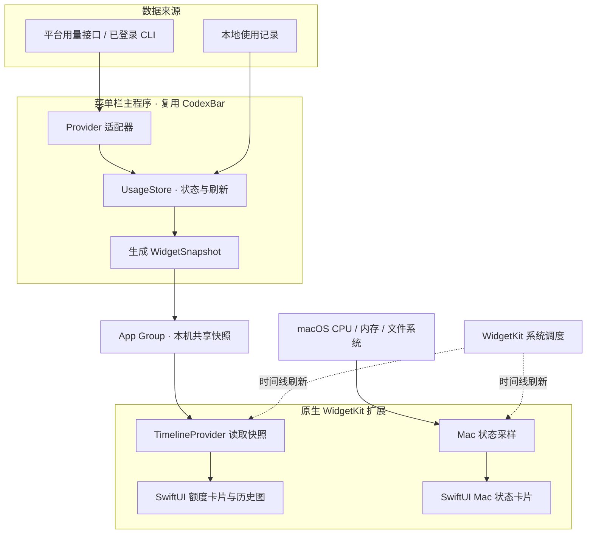

# 架构设计

AI Monitor 是基于 CodexBar 的 macOS 原生桌面组件定制版。设计重点是复用上游的数据接入与状态管理，将定制范围集中在 WidgetKit 展示层，并增加独立的本机状态采样组件。

[返回首页](README.md) · [安装指南](INSTALL.zh-CN.md) · [构建说明](BUILD.md)

## 1. 系统组成

这是主程序与系统组件之间的本机通信，不需要另装原版 CodexBar 作为后台数据服务。图中展示的是本项目的桌面组件主路径，不覆盖上游所有可选提供方和功能。

## 2. 模块职责与代码入口

| 层级 | 职责 | 代码入口 |
| --- | --- | --- |
| 数据接入 | 读取提供方数据、处理来源差异与账户状态 | [`Sources/CodexBarCore/Providers`](Sources/CodexBarCore/Providers) |
| 主程序状态 | 管理已取回的数据与刷新流程 | [`UsageStore`](Sources/CodexBar/UsageStore) |
| 快照发布 | 编码、保存快照，按需要请求组件重载 | [`UsageStore+WidgetSnapshot.swift`](Sources/CodexBar/UsageStore/UsageStore+WidgetSnapshot.swift) |
| 共享数据模型 | 保存提供方、时间戳、额度窗口与每日记录 | [`WidgetSnapshot.swift`](Sources/CodexBarCore/WidgetSnapshot.swift) |
| 组件时间线 | 从共享存储载入数据，生成系统展示条目 | [`CodexBarWidgetProvider.swift`](Sources/CodexBarWidget/CodexBarWidgetProvider.swift) |
| 定制 UI | 分段额度、历史图、布局与外观 | [`WidgetTiles.swift`](Sources/CodexBarWidget/WidgetTiles.swift)、[`WidgetDesignSystem.swift`](Sources/CodexBarWidget/WidgetDesignSystem.swift) |
| Mac 状态 | 采样系统计数器，构建独立时间线 | [`CodexBarWidgetBundle.swift`](Sources/CodexBarWidget/CodexBarWidgetBundle.swift) |

## 3. 两条数据路径

### AI 额度与使用记录

主程序按用户设置启用提供方，通过上游支持的接口或已登录 CLI 获取额度；历史使用记录由对应来源整理。`UsageStore` 将这些状态投影为 `WidgetSnapshot`，发布到本机共享存储。WidgetKit 扩展读取该快照，在用户选择的卡片尺寸与提供方下渲染。

本定制版没有新增一个代理服务器来转发额度请求，也没有在 UI 中重新推算平台额度。平台本身、所选来源、登录状态及上游解析规则仍然决定可用数据。

### Mac 状态

Mac 状态由组件自身读取本机指标，不经过 AI 提供方，也不依赖 AI 账户登录。

| 指标 | 当前实现 | 解读方式 |
| --- | --- | --- |
| CPU | `host_statistics` 计数器差值，8 次约 80 ms 间隔采样 | 约 0.64 秒内的短时采样；折线不是持续后台历史。 |
| 内存 | 活跃页 + 接线页 + 压缩页，乘页大小后除以物理内存 | 一种占用估算，口径不等同于活动监视器。 |
| 存储 | 用户目录所在文件系统的可用容量 | 按十进制 GB 显示；与系统对可清理空间的呈现可能不同。 |

## 4. 数据口径

| 展示项 | 含义 | 不应作出的推断 |
| --- | --- | --- |
| 额度百分比 | 来源提供的指定时间窗口用量；界面沿用上游的已用 / 剩余设置 | 不能直接换算成固定 token 数量或费用。 |
| 重置时间 | 来源提供的额度窗口重置信息 | 不代表刷新程序将在该时刻立即执行。 |
| 七日 token 图 | 按日整理的来源记录，以最后一个有效日期为终点展示七个日历日 | 未记录日期不等于零，也不代表账户完整计费账单。 |
| 更新时间 | 快照或条目中的来源时间信息 | 主程序取到新值与桌面显示新值可能存在时间差。 |

日历空缺保持为空；真实零值保留为零。组件库的占位预览可以使用示例数据，正常用量时间线缺少快照时使用空状态；预览图不能作为账户连接成功的证据。

## 5. 刷新模型

完整链路为：**来源更新 → 主程序取数 → 写入快照 → WidgetKit 展示**。任一环节都可能引入延迟。

- **提供方层**：不同来源有自己的缓存、会话与限流规则。Claude CLI 后台路径在 [`ClaudeCLIUsageSpawnThrottle.swift`](Sources/CodexBarCore/Providers/Claude/ClaudeCLIUsageSpawnThrottle.swift) 中设定 15 分钟最小启动间隔，不能简单理解为所有 Claude 来源都固定 15 分钟刷新。
- **主程序层**：按上游设置执行轮询，成功获取后发布状态。此前在本机 CLI 路径验证过后台自动更新；该结果不构成所有账户的刷新 SLA。
- **系统层**：WidgetKit 决定时间线实际执行与展示时机。应用请求重载不等于系统立即绘制。
- **Mac 状态**：请求下次采样时间为本次采样后 300 秒，系统可延后，页面因此标注“定时更新 · 以上次采样为准”。

UI 改版不改变平台数据口径，也不能消除上游缓存与系统调度限制。

## 6. 复用边界与兼容性

| 复用上游 | 本项目定制 |
| --- | --- |
| 提供方接入、额度模型、账户处理 | 深色渐变卡片与分段额度条 |
| 主程序刷新和共享快照机制 | 七日历史图的呈现与日期空缺处理 |
| WidgetKit 基础时间线与交互 | Mac 状态卡片及本地采样 |
| 锁定的依赖版本 | 应用显示名称、组件目录名称与打包入口 |

主程序保留 `com.steipete.codexbar.debug` 以兼容已有账户设置；Beta 2 组件采用 `com.steipete.codexbar.debug.aimonitor.widget` 独立扩展标识。App Group 与签名团队相关。旧桌面卡片需重新添加一次，不要同时运行多个主程序副本。原版 CodexBar 与本定制版还会沿用部分相同配置路径，建议择一运行。

## 7. 发布与验证边界

公开版本为 `0.1.0-beta.2`，应用内保留上游版本 `0.84.1`、构建号 `183`。当前仅提供 Apple Silicon 的开发签名构建，尚未公证；自动更新关闭，手动从本项目 Releases 更新。

已完成的本机验证与尚未覆盖的安装场景分别记录在 [版本验证说明](docs/ai-monitor/RELEASE-VALIDATION.md)。源码可供审阅，安全边界见 [安全与隐私说明](SECURITY-AI-MONITOR.md)。

## 8. 安装身份与黑屏回归

扩展启动服务以 Bundle ID 识别组件。将同一扩展从 Studio 路径移动到 AI Monitor 路径时，旧系统进程可能继续使用已缓存的旧可执行文件路径。Beta 2 在构建时设置独立扩展 ID，固定安装目录，并拒绝将旧扩展打入新包。问题的系统日志证据与真实桌面回归结果见 [黑屏修复报告](docs/ai-monitor/BLACK-SCREEN-FIX.md)。

## 实时桌面卡片（Beta 6）

`LiveMacCardController` 在主应用中管理无边框 NSPanel；`LiveMacSampler` 使用主运行循环上的 1 秒 Timer，读取 Mach CPU tick 差分、VM 内存统计、Swap 和系统压力等级。没有 sleep 阻塞采样；CPU 保留最多 30 点，磁盘读数缓存 30 秒。Swift Observation 将结果推送至 SwiftUI 卡片。

这是独立于 WidgetKit 的桌面窗口。休眠通知停止 Timer，唤醒时重置 CPU 基线并恢复，退出时清理观察者与 Timer。窗口采用桌面层级并保存位置；显示器变化导致位置完全离屏时，启动会移回主屏。1 秒为目标间隔，系统繁忙时可能有调度延迟，不是硬实时保证。

该卡片只读取本机系统指标，不读取账户凭据、不请求 AI 平台接口。与原有 WidgetKit 卡片并存以兼容旧布局。
