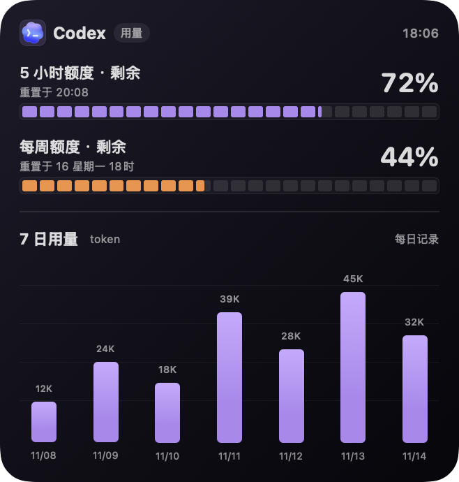

# AI Monitor

**把 Codex、Claude 的额度与 Mac 状态放到桌面。**

基于 [steipete/CodexBar](https://github.com/steipete/CodexBar) 的社区 UI 定制版，原名 CodexBar Studio。沿用上游的数据读取、账户接入与刷新机制，定制分段额度条、七日用量图和 Mac 状态卡片。**不是 CodexBar 官方发行版。**

## 下载与安装

**[下载 AI Monitor 安装包](https://github.com/hui77anna/AI-Monitor/releases/tag/v0.1.0-beta.1)** · [详细安装说明](INSTALL.zh-CN.md)

当前测试版：macOS 14 或更高版本，Apple Silicon（M1/M2/M3/M4/M5 等）；不支持 Intel Mac。

1. 在 Releases 下载 `AI-Monitor-0.1.0-beta.1-macos-arm64.dmg`。
2. 打开 DMG，将 **AI Monitor.app** 拖进 **Applications（应用程序）**，再从应用程序打开。
3. 使用自己的 Codex / Claude Code 登录，在菜单栏设置中启用对应提供方。安装包不包含任何人的账户、额度或登录凭据。
4. 桌面右键 → **编辑小组件** → 搜索 **AI Monitor**。添加“Mac 状态”中号，以及两张“AI Monitor 用量”，分别选择 Codex 和 Claude；大号用量卡片可显示历史图表。

**首版是开发证书签名的测试版，未做 Apple Developer ID 公证。** 首次打开可能被 macOS 拦截，需要自行核对来源后按系统提示允许打开。尚未在另一台全新 Mac 上验证，不承诺所有机器均可直接双击运行。不提供关闭系统安全保护的安装脚本。

## 外观

下图为实际 SwiftUI 渲染的**合成示例数据**，用于展示外观；实际安装显示你自己的账户数据，缺失值不会用示例填充。

## 数据与刷新

- Codex 紫色历史图、Claude 橙色额度条；上游支持的可用额度、重置时间和历史记录按来源呈现。
- 额度百分比与 token 历史是不同指标，不能直接互相换算。
- Claude 可在设置中选 CLI 来源，沿用 Claude Code 的 `/usage`。上游 CLI 后台缓存至少 15 分钟；结合轮询通常约 15–20 分钟取一次新值，系统组件显示还受 WidgetKit 调度影响。不是秒级实时。
- Mac 状态在本机采样 CPU、内存与可用存储，请求约每 5 分钟刷新；系统可延后。内存统计口径与活动监视器可能不同。
- 登录过期、接口变化或无数据时可能不可用；不会制造假额度。新安装没有本地历史时图表可能为空。

## 构建与来源

基于上游提交 `7447bc77c2497323d9c41e40164ce705533493c8`（0.84.1）。[构建说明](BUILD.md) · [上游 README](README.upstream.md) · [安全说明](SECURITY-AI-MONITOR.md)。

本版保留上游模块名和内部 debug Bundle ID，以兼容已有 CodexBar Studio 组件；两者应择一安装运行。菜单或设置中的部分名称仍为 CodexBar。上游原版与本定制版共用 CodexBar 配置路径，不建议同时运行。

界面根据参考卡片重新实现，未取得小红书图片作者的源码，不代表与该作者合作。保留上游 [MIT 许可证及版权声明](LICENSE)，品牌标识归各自权利人。源码可审阅、修改、重新构建；开源不等于零风险。

当前未启用上游发布工作流与自动更新，避免将定制界面覆盖成官方版本。更新请下载本仓库 Releases。
