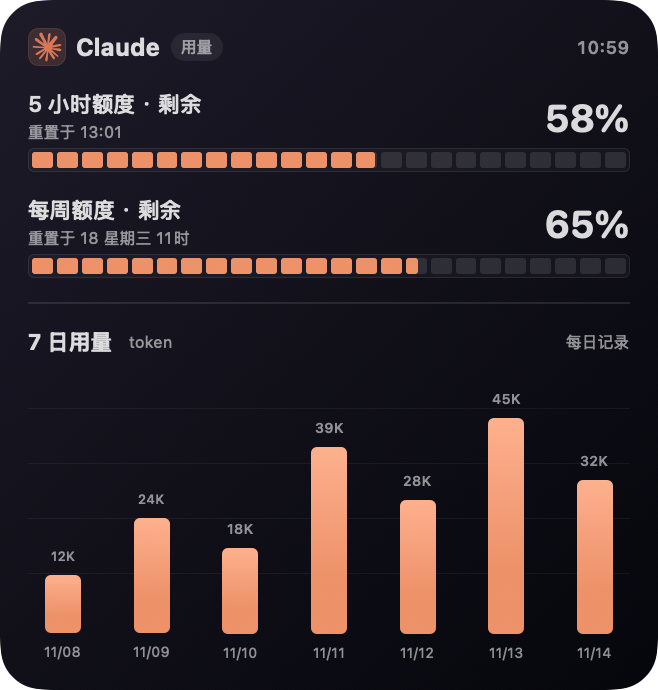
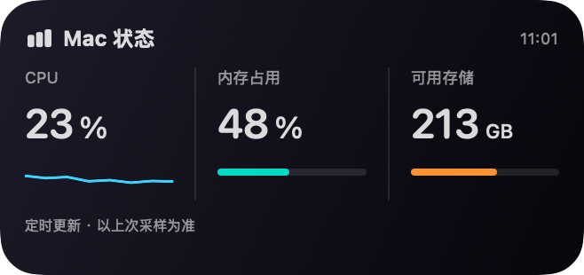
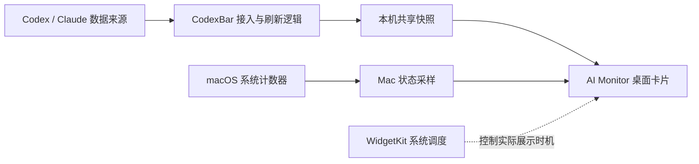

# AI Monitor

### AI 额度，一眼掌握。

为 macOS 桌面设计的 Codex / Claude 用量组件。
额度、重置时间、七日用量与 Mac 状态，在熟悉的桌面上集中呈现。

**[下载安装包](https://github.com/hui77anna/AI-Monitor/releases/download/v0.1.0-beta.3/AI-Monitor-0.1.0-beta.3-macos-arm64.dmg)** · [安装指南](INSTALL.zh-CN.md) · [架构设计](ARCHITECTURE.md) · [发布记录](https://github.com/hui77anna/AI-Monitor/releases)

基于 [CodexBar](https://github.com/steipete/CodexBar) 的社区 UI 定制项目 · SwiftUI / WidgetKit 原生组件

> **Beta 3 · Build 184**：统一应用、组件库名称与提示文字为 **AI Monitor**。延续 Beta 2 的切换黑屏修复；60 次桌面切换回归记录来自 Beta 2。[下载最新版](https://github.com/hui77anna/AI-Monitor/releases/tag/v0.1.0-beta.3) · [根因与测试记录](docs/ai-monitor/BLACK-SCREEN-FIX.md)

## 桌面预览

**当前下载版本：AI Monitor Beta 3（Build 184）** · [下载 macOS 安装包](https://github.com/hui77anna/AI-Monitor/releases/download/v0.1.0-beta.3/AI-Monitor-0.1.0-beta.3-macos-arm64.dmg)

安装后在“编辑小组件”左侧选择 **AI Monitor**。旧 Studio 用户若仍看到旧名称，请参阅[名称缓存处理说明](INSTALL.zh-CN.md#升级后左侧仍显示-codexbar-studio)。

<table>
<tr>
<td width="50%" align="center"><strong>AI Monitor · Codex · 额度与七日用量</strong></td>
<td width="50%" align="center"><strong>AI Monitor · Claude · 额度与七日用量</strong></td>
</tr>
<tr>
<td></td>
<td></td>
</tr>
<tr>
<td align="center"><strong>AI Monitor · Mac 状态 · CPU / 内存 / 存储</strong></td>
<td align="center"><strong>AI Monitor · 紧凑布局 · Claude 中号卡片</strong></td>
</tr>
<tr>
<td></td>
<td></td>
</tr>
</table>

以上图片于 2026-11-16 从 Beta 3（Build 184）对应的 SwiftUI 组件代码重新渲染，使用明确的示例数据展示布局，不是设计稿，也不是任何用户的实际额度。实际显示内容取决于账户、数据来源和系统配色。[截图生成方式](docs/ai-monitor/SCREENSHOTS.md)

## 为日常使用设计

| 能力 | 使用体验 |
| --- | --- |
| **额度概览** | 分段进度条显示来源提供的额度比例，配合重置时间查看当前用量窗口。 |
| **七日用量** | 大号卡片提供 token 历史图，保留日期空缺，区分无记录与零用量。 |
| **多种尺寸** | 用量卡片支持小、中、大尺寸；Mac 状态支持小、中尺寸。 |
| **本机状态** | 查看 CPU 采样值、内存占用估算与磁盘可用容量。 |
| **原生桌面集成** | 通过 macOS 小组件库添加；支持系统全彩、单色与染色外观。 |
| **成熟的接入基础** | 复用 CodexBar 的提供方适配、账户处理与刷新机制，无需另开一套中转程序。 |

## 三步开始

1. **安装应用**：下载 DMG，将 `AI Monitor.app` 拖入“应用程序”，然后打开。应用常驻菜单栏。
2. **连接账户**：先在 Codex / Claude Code 中登录自己的账户，再在应用设置中启用对应提供方。
3. **添加组件**：桌面右键 → **编辑小组件** → 搜索 **AI Monitor**，添加“用量”或“Mac 状态”。

推荐组合：Codex 大号 + Claude 中号 + Mac 状态中号。使用大号卡片可以查看更多历史记录；首次安装没有历史时，图表可能为空。

> **当前发布状态：公开测试版。** 支持 Apple Silicon 与 macOS 14+；Intel 暂不支持。安装包已完成本机签名、运行与完整性检查，尚未做 Apple Developer ID 公证或异机安装验收。首次启动可能需要按 macOS 提示确认。[安装与故障排查](INSTALL.zh-CN.md)

## 数据从哪里来

AI Monitor 定制桌面展示，额度读取沿用 CodexBar。主程序取回并整理数据，通过本机 App Group 快照交给 WidgetKit；Mac 状态卡片直接采样本机系统指标。

**准确性与更新速度是两件事。** 本定制版不重新估算平台额度；数据是否完整取决于来源，何时显示取决于取数缓存、刷新周期与系统调度。Claude CLI 后台路径有 15 分钟最小间隔；Mac 状态请求约每 5 分钟刷新，均不代表秒级实时。

[阅读架构、数据口径与刷新机制 →](ARCHITECTURE.md)

## 项目与发布信息

| 项目 | 当前状态 |
| --- | --- |
| 对外版本 | `0.1.0-beta.3` |
| 应用内部版本 | `0.84.1` / Build `184`，保留上游版本以追踪兼容性 |
| 上游基线 | [steipete/CodexBar · 7447bc7](https://github.com/steipete/CodexBar/commit/7447bc77c2497323d9c41e40164ce705533493c8) |
| 主要变更 | 桌面卡片 UI、Mac 状态组件、显示名称与打包脚本 |
| 更新方式 | 从本仓库 Releases 手动下载，当前不启用自动更新 |
| 问题反馈 | [GitHub Issues](https://github.com/hui77anna/AI-Monitor/issues) |

安装包不附带开发者的账户配置、登录凭据或用量历史。额度查询仍需用户自己的授权；开源代码可供审阅，但不等于独立安全审计。[安全与隐私说明](SECURITY-AI-MONITOR.md)

<strong>常见问题</strong>

**安装后就是截图里的 UI 吗？**
是同一套组件视图。数值、可用字段与历史记录来自你的账户；系统单色或染色设置会改变颜色。

**这是 CodexBar 官方版本吗？**
不是。AI Monitor 是基于 CodexBar 的社区定制版，原名 CodexBar Studio，保留上游数据能力并修改桌面展示。

**是否需要同时运行原版 CodexBar？**
不需要。AI Monitor 包含完整主程序。请退出旧 CodexBar Studio，避免重复运行；本版保留主程序账户设置兼容性，并沿用 CodexBar 配置路径；组件已采用独立扩展标识，旧卡片需重新添加一次。

**为什么数字没有立即变化？**
提供方缓存、后台轮询与 WidgetKit 分别控制不同阶段。平台额度与本地 token 记录的更新时机也不同，详情见架构文档。

**能看到其他人的用量吗？**
安装包不会提供其他人的账户或数据。默认展示本机已授权数据来源的结果。

## 文档与致谢

[安装指南](INSTALL.zh-CN.md) · [架构设计](ARCHITECTURE.md) · [源码构建](BUILD.md) · [版本验证](docs/ai-monitor/RELEASE-VALIDATION.md) · [安全说明](SECURITY-AI-MONITOR.md)

感谢 [CodexBar](https://github.com/steipete/CodexBar) 作者及贡献者提供基础实现。本项目保留 [MIT 许可证与上游版权声明](LICENSE)，原项目文档见 [README.upstream.md](README.upstream.md)。产品标识归各自权利人；本项目与 OpenAI、Anthropic 及参考图片作者不存在官方合作关系。
